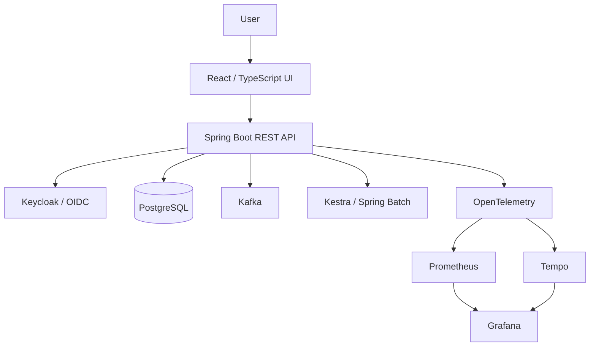

# AgentOps AI — System Architecture

**Status:** Proposed application architecture; infrastructure foundation partially configured; no OCI VM deployed.  
**Last reviewed:** 2026-10-28

## Purpose
AgentOps AI is an end-to-end portfolio application demonstrating secure full-stack engineering, event-driven workflows, infrastructure as code, CI/CD, and observability. The application domain and detailed user stories still require approval; this is a target technical architecture, not a claim that components are running.

## Logical architecture

## Component responsibilities
| Component | Planned responsibility | Status |
|---|---|---|
| React / TypeScript | Web client and authenticated UI | Planned |
| Java 21 / Spring Boot 3.2.5 | Multi-module application and REST endpoints | Planned |
| Spring Data JPA / Hibernate | Database persistence | Selected, not implemented |
| PostgreSQL / Liquibase | Relational data and versioned schema | Selected, not implemented |
| Keycloak | Authentication, SSO and role-based access | Selected, not implemented |
| Kafka | Asynchronous event transport | Selected, not implemented |
| Kestra / Spring Batch | Orchestration and scheduled/batch jobs | Selected, not implemented |
| OpenTelemetry / Prometheus / Grafana / Tempo | Metrics and distributed tracing | Selected, not implemented |
| Docker Compose | Local development environment | Planned |
| Terraform / OCI | Cloud infrastructure | Configured in part; compute blocked |

## Deployment boundaries
- **Local:** Docker Compose for development and reproducible demonstrations.
- **CI:** GitHub Actions for validation, tests, scanning and explicitly authorized provisioning.
- **Cloud:** OCI Ashburn was selected as a free-tier-first target; no compute instance exists.
- **DNS:** A domain and Cloudflare were discussed/configured separately; public application routing is not verified.

## Security and operational requirements
Use least-privilege IAM, OIDC, secret injection rather than committed credentials, explicit environment separation, TLS, audit logs, health checks, and guarded Terraform operations. Production-grade controls are requirements, not completed implementations.

## Open decisions
Confirm business use cases, module boundaries, API contracts, Kafka topic design, authorization matrix, secrets management implementation, deployment topology, and non-OCI fallback.
